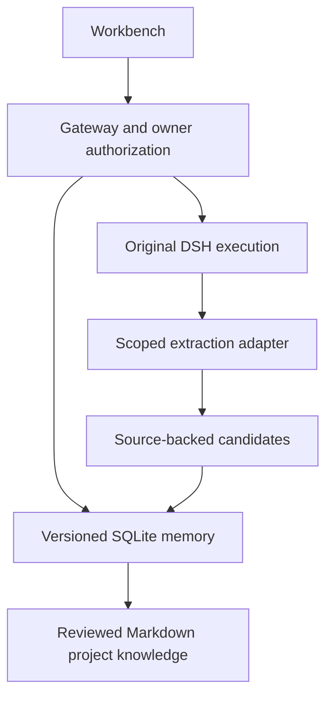

# System architecture

## Overview
The standalone local runtime lives in src/. The extended Gateway lives in packages/gateway/. The session adapter integrates original DSH sessions with trusted Gateway identities. Their contracts are distinct.

## Module graph

## Constraints
Preserve original DSH planning, permissions, cancellation, leases and model usage accounting. A source or memory is data, never authority. The extraction adapter and reviewed Markdown publication are integration work in progress; installed packages do not prove production activation.
